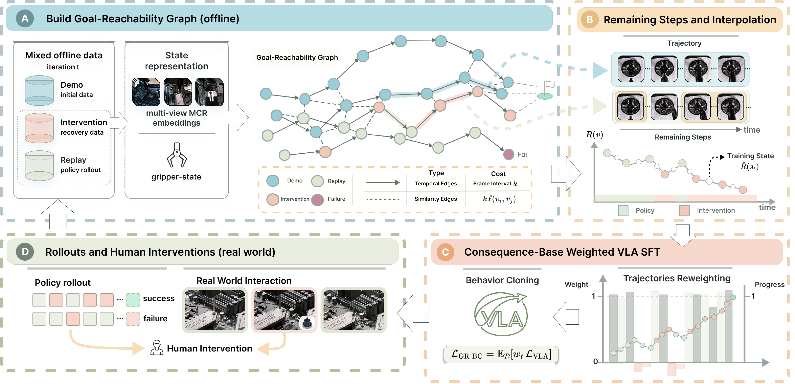

<h3 align="center">Graph-Reweighted Behavior Cloning with Human Interventions<br>for Precise Robotic Manipulation</h3>

<div align="center">
  <p><strong>CoRL 2026</strong></p>
  <p>
    <a href="https://github.com/Xiaoman521">Xiaoman Li</a><sup>1,2</sup>&nbsp;&nbsp;
    <a href="https://openreview.net/profile?id=~Zhiqiang_Yang5">Zhiqiang Yang</a><sup>2,3</sup>&nbsp;&nbsp;
    <a href="https://openreview.net/profile?id=~Jiayu_Hu4">Jiayu Hu</a><sup>2,4</sup>&nbsp;&nbsp;
    <a href="https://kongjipeng.github.io/">Jipeng Kong</a><sup>2,5</sup><br>
    <a href="https://breez3young.github.io/">Yang Zhang</a><sup>2,6</sup>&nbsp;&nbsp;
    <a href="https://openreview.net/profile?id=~waylen_zhang3">Jingwei Zhang</a><sup>2,3</sup>&nbsp;&nbsp;
    <a href="https://dblp.org/pid/409/1301.html">Fangzheng Yan</a><sup>2</sup>&nbsp;&nbsp;
    <a href="https://cshen.github.io/">Chunhua Shen</a><sup>1,&dagger;</sup>&nbsp;&nbsp;
    <a href="https://baichenjia.cn/">Chenjia Bai</a><sup>2,7,&dagger;</sup>
  </p>
  <p>
    <sup>1</sup>Zhejiang University, State Key Lab of CAD &amp; CG<br>
    <sup>2</sup>The Institute of Artificial Intelligence, China Telecom (TeleAI)<br>
    <sup>3</sup>South China University of Technology&nbsp;&nbsp;
    <sup>4</sup>University of Science and Technology of China<br>
    <sup>5</sup>ShanghaiTech University&nbsp;&nbsp;
    <sup>6</sup>Tsinghua University&nbsp;&nbsp;
    <sup>7</sup>Gamma Robotics
  </p>
  <p><sup>&dagger;</sup> Corresponding authors</p>
</div>

<p align="center">
  <a href="https://arxiv.org/abs/2610.20504"></a>
  <a href="https://gr-bc.github.io/"></a>
  <a href="docs/TRAINING.md"></a>
  <a href="LICENSE"></a>
</p>

<div align="center">
  
  <p><em>Learn from progress-making action chunks, including recoveries inside imperfect trajectories, without training a reward model or critic.</em></p>
</div>

<p align="center">
  <a href="#installation">Installation</a> &middot;
  <a href="#generate-weights">Generate weights</a> &middot;
  <a href="#weighted-sft">Train VLAs</a> &middot;
  <a href="#visualize-and-evaluate">Visualize and evaluate</a> &middot;
  <a href="#license-and-citation">Citation</a>
</p>

## 📣 Updates

- 🚀 **2026-10-16:** Code released, with graph weighting, VLA training, and visualization tools.
- 📄 **2026-10-14:** [Paper](https://arxiv.org/abs/2610.20504) available on arXiv.
- 🎉 **2026-10-05:** GR-BC accepted to **CoRL 2026**!

[Data](docs/DATA.md) | [Training](docs/TRAINING.md) | [Evaluation](docs/EVALUATION.md) | [Method notes](docs/METHOD.md)

## To-do List

- [x] Release graph weighting and progress visualization.
- [x] Support weighted SFT for SmolVLA, X-VLA, and pi0.5.
- [ ] Release code combining RLT with GR-BC for online RL training.

## Installation

Use a fresh Python environment with a compatible PyTorch/CUDA setup.

```bash
git clone https://github.com/Gamma-Robot/GR-BC.git
cd GR-BC
conda create -n grbc python=3.11 -y
conda activate grbc
python -m pip install torch==2.7.1 torchvision==0.22.1 --index-url https://download.pytorch.org/whl/cu128
python -m pip install -e '.[grbc,smolvla,xvla]'
```

The CUDA 12.8 wheels above support RTX 50-series GPUs; use a compatible NVIDIA driver. See the [short smoke test](docs/REPRODUCE.md) to check graph generation, progress plots, and training before a full run.

For **pi0.5**, use a separate environment and install `'.[grbc,pi]'` instead; its custom Transformers dependency conflicts with the other backbone extras.

Download the official **MCR ResNet50** checkpoint from [Robots Pre-Train Robots](https://huggingface.co/GqJiang/robots-pretrain-robots). Model checkpoints and private datasets are not bundled.

```bash
hf download GqJiang/robots-pretrain-robots mcr_resnet50.pth --local-dir checkpoints/mcr
```

## Prepare Data

Prepare each task in **LeRobot v3.0 dataset format**, including synchronized camera views, robot states/actions, and genuine success/reward labels. See the [dataset guide](docs/DATA.md).

```bash
export DATASET_ROOT=/absolute/path/to/task_v3
export MCR_CKPT=/absolute/path/to/mcr_resnet50.pth
```

## Generate Weights

```bash
grbc-export \
  --dataset "$DATASET_ROOT" --mcr-ckpt "$MCR_CKPT" \
  --output-dir outputs/task
```

The run produces per-frame `transition_weights.parquet`, graph artifacts, and diagnostic figures without modifying the input dataset. **Keep the original dataset frame IDs unchanged for training.** Configurations and history-aware usage are documented in the [method notes](docs/METHOD.md); the resolved settings are saved with each run.

## Weighted SFT

```bash
export WEIGHTS_PATH="$PWD/outputs/task/transition_weights.parquet"
export OUTPUT_DIR="$PWD/outputs/train_smolvla"
bash scripts/train_smolvla.sh
```

Use `scripts/train_xvla.sh` or `scripts/train_pi05.sh` for the other backbones. Each launcher selects its matching base checkpoint; set `PRETRAINED_PATH` only to override it. Add `--dry-run` to inspect a command first; set `USE_GRBC=false` for uniform SFT. See [training instructions](docs/TRAINING.md) for multi-GPU execution and checkpoint requirements.

## Visualize and Evaluate

```bash
grbc-visualize --run outputs/task --episodes 0 1 6
grbc-evaluate --run outputs/task
```

Visualize dense progress/weight curves, graph structure, camera frames, and actual shortest paths. The [evaluation guide](docs/EVALUATION.md) also covers fixed-episode comparisons, isolated-query graph evaluation, and offline checkpoint validation. These diagnostics are not a substitute for closed-loop policy evaluation. See [validation scope](docs/VALIDATION.md) for completed checks.

## License and Citation

Code is released under [Apache-2.0](LICENSE), retaining upstream notices. Pretrained checkpoints remain subject to their original terms. If you use this work, please cite:

```bibtex
@misc{li2026graphreweighted,
  title={Graph-Reweighted Behavior Cloning with Human Interventions for Precise Robotic Manipulation},
  author={Xiaoman Li and Zhiqiang Yang and Jiayu Hu and Jipeng Kong and Yang Zhang and Jingwei Zhang and Fangzheng Yan and Chunhua Shen and Chenjia Bai},
  year={2026},
  eprint={2610.20504},
  archivePrefix={arXiv},
  primaryClass={cs.RO},
  url={https://arxiv.org/abs/2610.20504}
}
```

Built on [LeRobot](https://github.com/huggingface/lerobot) and [MCR](https://github.com/luccachiang/robots-pretrain-robots), with README presentation inspired by [Pi3](https://github.com/yyfz/Pi3). The main figure is Figure 1 of our paper; see [asset notes](assets/README.md) and [acknowledgements](docs/ACKNOWLEDGEMENTS.md).
